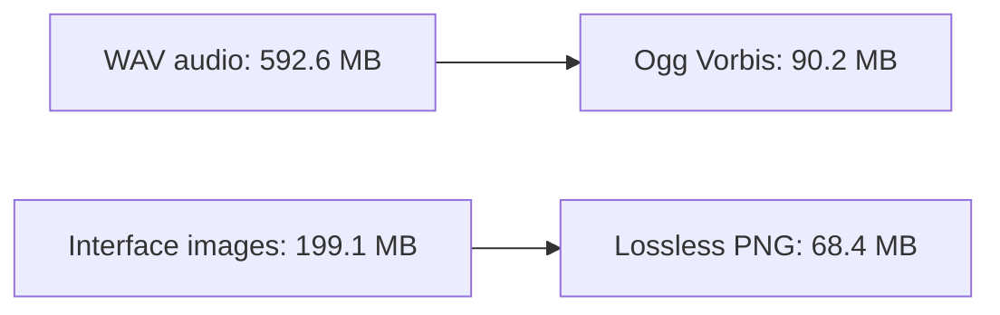

# Changes

This log records delivered changes and data-package updates. Client data is hosted separately on Drive; changing it does not automatically produce a new executable release.

## Unreleased

- Move the data editor to the independent [GX Studio](https://github.com/Spelunkern/GX-Studio) project. Client builds and new GX packages omit the retired Go editor.

## gx-v0.1.16

[Patch notes](docs/releases/gx-v0.1.16.md) · [Upgrade guide](docs/releases/gx-v0.1.16-upgrade.md).

- Add underwater oxygen and drowning, and improve ground contact, jumps and dungeon transitions.
- Restore equipment speed bonuses after revival, keep Status values current and fix warehouse dragging.
- Restore original control details and save screenshots as PNG in the background.

## gx-v0.1.15 — 2026-11-21

[Patch notes](docs/releases/gx-v0.1.15.md) · [Upgrade guide](docs/releases/gx-v0.1.15-upgrade.md).

- Restore portal trigger volumes, original consumable effects, cape emblems and character feedback.
- Update guild founding, ranking battles, user options, combat audio and the schema-35 development seed.

## gx-v0.1.14 — 2026-11-20

[Patch notes](docs/releases/gx-v0.1.14.md) · [Upgrade guide](docs/releases/gx-v0.1.14-upgrade.md).

- Add personal markets, guild house rates, larger raids, shared loot and Perfect Party experience.
- Expand quest rules and add Transformation, Disguise, Evolution and Soul Burn. Update combat formulas, periodic effects and resource drains.
- Batch world rendering and restore native VANI alpha passes, NPC conversations and guild panels.
- Ship native Linux and Windows builds with the GX Studio editor, terminal GX Server and the schema-31 development seed. Keep setup and upgrade guides in the repository.

## gx-v0.1.13 — 2026-11-19

[Patch notes](docs/releases/gx-v0.1.13.md) · [Discord summary](docs/releases/gx-v0.1.13-discord.md) · [Upgrade guide](docs/releases/gx-v0.1.13-upgrade.md).

- Add the realm-wide Auction House with transactional escrow, item-family filters, favorites, and claims.
- Ship GX Studio with recoverable SData and SQLite catalog editing.
- Extend travel, guards, weather, dungeon ambience, notices, progression, loot, and combat behavior.
- Restore chat controls, item links, extra shortcut bars and Revolver, and improve minimap zoom and skeletal animation.
- Refresh the distributed development seed, dual-platform packages and Wiki.

## gx-v0.1.12 — 2026-11-17

[Patch notes](docs/releases/gx-v0.1.12.md) · [Discord summary](docs/releases/gx-v0.1.12-discord.md) · [Upgrade guide](docs/releases/gx-v0.1.12-upgrade.md).

- Acknowledge every self cross-map placement so repeated teleports do not leave the server waiting for map load.
- Share the initial-entry/transfer acknowledgement between graphical, CLI and protocol-fixture clients, with duplicate/foreign/malformed-packet coverage.
- Verify seven consecutive GM map commands with gameplay barriers and logout; refresh protocol documentation.
- Preserve existing v0.1.11 data, SQLite runtime and configuration; no new migration is required for this hotfix.

## gx-v0.1.11 — 2026-11-16

[Patch notes](docs/releases/gx-v0.1.11.md) · [Discord summary](docs/releases/gx-v0.1.11-discord.md) · [Upgrade guide](docs/releases/gx-v0.1.11-upgrade.md).

- Correct Wind Spin, Stinger, prepared casts, Blizzard, pools and original skill/item presentation.
- Correct meteor/contact/spawn/corpse placement, combat stance, monster scale, quest drops and classic group-respawn timing.
- Activate the documented modern Lua monster-AI catalog and restore recharge/miss feedback.
- Make trade, quest and economy/inventory persistence atomic; modernize world scheduling, bounded networking, SQLite migrations and recovery.
- Add Argon2id/revocation, long-password support, remote TLS, rotating logs, diagnostics and authenticated shutdown.
- Remove the server GUI/icon/Fyne; ship the terminal console and CGO-free login/world services.
- Reduce animation/bounds/effect CPU work without changing visible sampling or shadow/reflection scope; add reproducible measurements.
- Expand the common server/protocol Wiki, update Go 1.27.4 and validate native Linux/Windows CI.
- Retain SQLite as the primary embedded production database and preserve existing mutable runtimes.

## gx-v0.1.10 — 2026-11-15

[Brief patch notes](docs/releases/gx-v0.1.10.md) · [Upgrade and data requirements](docs/releases/gx-v0.1.10-upgrade.md).

- Complete authoritative single/two-seat mounts, native casting/appearance audio and effects, jumping, reverse walking and external racial bone bindings.
- Restore four innate ITM glows, physical ranged projectiles, skill recovery/combos and original combat feedback.
- Complete ladders, dungeon click movement/minimaps, persistent obelisks and goddess blessing; extend all 31 PvP ranks and Warrior Rewards.
- Correct chat, guild captions, item icons, portraits, pickups, cooldowns, Stat armor affinity and Z/X quantities; reduce cursor/collision/mob overhead.
- Restore half-strength fall damage by default and publish matching protocol 0x11122209 native Linux/Windows portables. Preserve existing runtimes and migrate mount definitions explicitly.

## gx-v0.1.9 — 2026-11-14

[Patch notes](docs/releases/gx-v0.1.9.md). Authoritative terrain/dungeon movement,
collision/navigation, jumping and speed rules; GM map teleport and OJ limit
synchronization, with native client/server portables and 68-map physics resources.

## gx-v0.1.8 — 2026-11-14

Resilient startup with interface placeholders, persistent diagnostics and visible
blocking errors. Refresh the distributed development database and data download;
rebuild native Linux/Windows client and server portables. The cumulative
[Discord-sized patch notes](docs/releases/gx-v0.1.8.md) also summarize gx-v0.1.7.

## gx-v0.1.7 — November 14, 2026

[Full patch notes](docs/releases/gx-v0.1.7.md).

- Stabilize coincident world surfaces and opaque NPC armor; preserve cutout foliage, terrain and authored geometry.
- Allow Inventory, Status, Skills and Actions to remain open together with correct input ownership.
- Add nine recreation stat removers and a general remover; repair all 27 older bundle variants alongside the 28 GX variants.
- Restore native insufficient-gold notices, show yellow lapisia costs and retain only the native Used rune message.
- Synchronize 310 mall products and full stacks; make purchases and gifts atomic and preserve remaining legacy gift quantities.
- Publish updated native client/server portables, patch notes and a combined binary-only Cliente/Servidor distribution option.

## gx-v0.1.6 — November 14, 2026

[Full patch notes](docs/releases/gx-v0.1.6.md).

- Complete native blacksmith workflows, directed recreation, elemental combat and item badges.
- Add authoritative stealth, GM protection and map-wide quest metadata with event-driven client caching.
- Correct HUD presentation, equipment-bar switching, actor depth and ground-item labels; publish native client/server portables and the gameplay wiki.

## gx-v0.1.5 — November 13, 2026

[Full patch notes](docs/releases/gx-v0.1.5.md).

- Publish native client/server builds with external Wine Tahoma and lazy Noto Unicode/colour-emoji fonts and licenses.
- Restore environmental/map audio and its volume slider, water animations/effects and terrain footsteps.
- Correct casting, nameplates, item counts, inventory lighting, chat colours/bubbles, NPC patrols and skill/subaction audio/animation paths.
- Add approach-to-pickup/interact, movable native NPC/portrait/target/minimap/potion controls, loading artwork and World Map labels/previews.
- Retain only the local character shadow, reduce index storage and remove dungeon fog; conservative dungeon visibility/instancing reduces measured world draws by 84–90% across tested views.
- Add authoritative Admin 0/1 GM roles, the light-blue tag and six commands, including `/nmake type id`. Include complete GM documentation and GM test-account fixtures.

## gx-v0.1.4 — November 13, 2026

[Full accumulated patch notes](docs/releases/gx-v0.1.4.md).

### Gameplay fixes

- Reject skills locally when the known MP/SP budget is insufficient, with SysMsg 214 and the MP/SP label; recheck queued skills on reaching their target before sending or predicting animation.
- Remove floating labels from dropped items and route model clicks through pickup approach using the server's ten-unit range with a safety margin.
- Select the local player through the portrait or F2, with their name and current HP in the target frame.
- Announce friendly healing only after the recipient applies it; combat numbers reflect effective HP restored, and zero gain produces no number. Mob life drain also reports only actual HP gained.

### Documentation

- Visible screenshots at the top of the README and a full gallery.
- Contribution direction: original functional Shaiya foundation, Go and OpenGL 4.5, Linux as primary development platform and Windows support.
- Complete Linux/Windows portable client download on Drive, separate from executable-only GitHub release packages.
- Functional workflow status, supported-format tables and an explanation of the on-screen performance metrics.

### HUD, text and rendering

- Persist independently dragged player/target frames; keep the compact clock and expanded-map name in their original roles.
- Restore the original simple blue casting bar, filling with progress.
- Add persistent resolution/fullscreen selection with OK/Cancel and input ownership.
- Support UTF-8 client/server text, grapheme-safe editing and fixed byte budgets; embed redistributable Liberation Sans with Arial-compatible metrics and documented glyph limits.
- Refresh duel wins/losses without reconnecting.
- Fix Dispel destination-alpha artifacts and keep animated water visible when advanced water effects are disabled.
- Prefer dedicated GPUs at startup where recognized, while preserving explicit driver overrides.
- Add conservative terrain/sector visibility, bounded CPU streaming, prepared resource lists, matrix/uniform reuse and conservative object LOD; document measured benefits and remaining stalls.
- Publish updated native Windows/Linux client and server packages with accumulated notes and checksums. The Drive data bundle is unchanged.

## gx-v0.1.3 — November 13, 2026

- Publish native Linux and Windows client packages with checksums, notices and licenses alongside GX Server portables.
- Name client executables `Shaiya GX` and `Shaiya GX.exe`.
- Load loose `data/` beside the executable, independent of the working directory. SAH/SAF remain import formats rather than the game runtime layout.
- Decode Ogg Vorbis in Go at runtime. Convert the original 1,081 WAV resources to OGG during data preparation; converted audio uses libvorbis quality 6 at 44100 Hz. No external media codec is required to play.
- Convert 990 interface images from TGA/DDS/JPEG/BMP to lossless optimized PNG. Preserve alpha, distinct `_dds.png` atlases and authored mip levels in the optional `gxMP` PNG chunk. Other 3D textures keep their original formats.
- Convert seven CUR files to lossless PNG cursors and preserve their `(0,0)` hotspots.
- Embed Wine Tahoma and Open Sans; remove external font requirements.
- Retarget known sound references during import, with a guard against coincidental `.wav` bytes in binary geometry.

### Media conversion measurements

Historical conversion totals before later resource pruning. These compare the same source resources before and after conversion, not the current Drive archive size.

Audio reduction uses lossy Vorbis quality 6. PNG reduction preserves decoded pixels and authored mipmaps; it does not resize or quantize the interface.

### Separately distributed data updates

- Replace the active `Character/Skill.SData` using the author's `Skill4.SData`, identified by Parsec as EP6 and converted to EP5: 326 groups, nine slots per group, no active skills in discarded slots 10–15.
- Limit playable client maps to IDs 0–67 while retaining login and both factions' creation/selection scenes. Remove unsupported map resources and orphan Field/dungeon assets while preserving shared references.
- Remove unused models, textures, sounds, `holes.bin` and `Terrain/Brush` through conservative reference audits. The latest local audited data snapshot is 1,732,686,151 bytes (about 1.73 GB); the external Drive archive has not been independently hashed against that snapshot.
- These conversion counts describe migration history, not current file counts after pruning. Original resources and removal manifests remain in private backups outside the distribution.

## gx-v0.1.2 — November 13, 2026

- Integrate the former Rapture directly as GX Server in the root Go repository/module.
- Publish Windows/Linux server portables with GUI, console, login and world services.
- Distribute the explicitly requested development database with test accounts, characters and inventory, retaining compatibility environment keys and database filenames.
- Keep SQLite as an embedded development convenience, with a future backend replacement planned.

See [releases](https://github.com/Spelunkern/Shaiya-GX/releases), [progress](docs/progress.md) and [format details](docs/data-formats.md).
